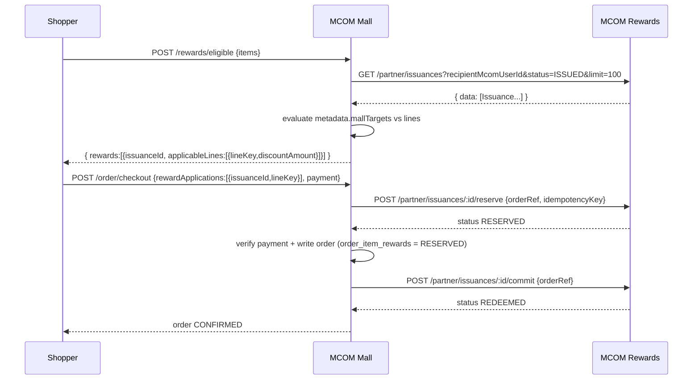
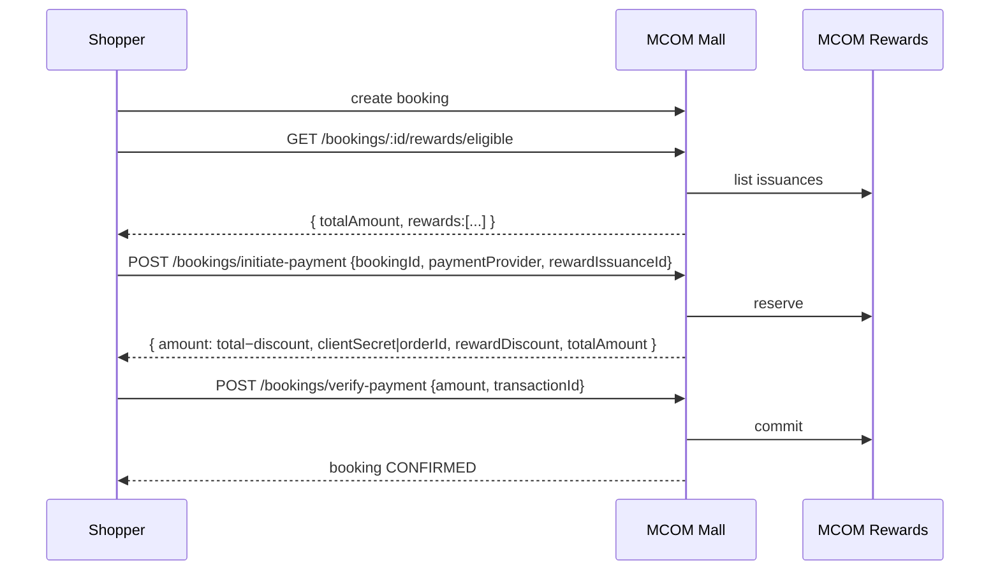
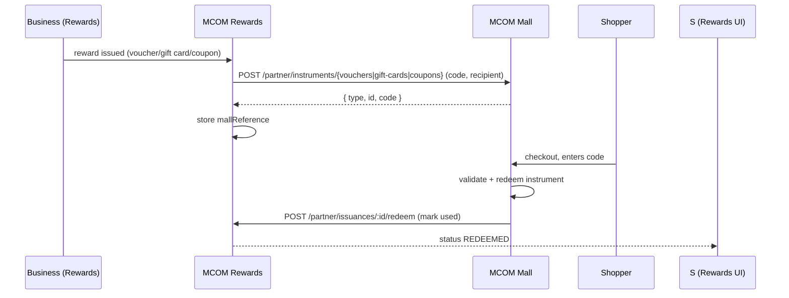

# MCOM Rewards ⇄ MCOM Mall — Integration Handbook (v3)

**Audience:** MCOM Rewards backend, frontend, and platform engineers
**Prepared by:** MCOM Mall team
**Protocol version:** `2026-10-01` (zero-hop RS256 service mesh)
**Status:** Mall side is implemented, migration-recorded, and shipped behind a feature flag. This document contains everything needed to complete the Rewards side.

> **Read this first (30-second version).**
> The mall can already *list* a shopper's earned rewards, *apply* a discount to a cart line or a service booking, *reserve → commit → release* against the reward, *show* reward vouchers/gift cards/coupons, and *materialise* instruments on request. For it to go live, Rewards must:
> 1. Let the mall through the ecosystem mesh (Central Console scopes/policies).
> 2. Let permitted peers **list a user's issuances** (not just the issuer's own).
> 3. Add a `RESERVED` status + `reserve` / `commit` / `release` endpoints.
> 4. Expose mall discount targeting in `metadata.mallTargets`.
> 5. Allow permitted peers to `redeem` a code-based issuance.
> 6. Let the business console target mall products/services (via `/partner/catalog`).
> 7. Point lifecycle events at mall (`/partner/events`) and call `/partner/instruments/*` instead of the old `/system/*` key endpoints.
>
> No shared secrets, no webhook keys, no IP allowlists between apps. Everything is an RS256 service token verified offline via Central's JWKS.

---

## Table of contents

1. [What changed in v3](#1-what-changed-in-v3)
2. [Architecture & terminology](#2-architecture--terminology)
3. [Zero-hop authentication model](#3-zero-hop-authentication-model)
4. [Central Console configuration](#4-central-console-configuration)
5. [Rewards → Mall API (what Rewards calls)](#5-rewards--mall-api-what-rewards-calls)
6. [Mall → Rewards API (what Rewards must build)](#6-mall--rewards-api-what-rewards-must-build)
7. [Discount targeting (`metadata.mallTargets`) & math](#7-discount-targeting-metadatamalltargets--math)
8. [Reward lifecycle state machine](#8-reward-lifecycle-state-machine)
9. [Data types & shapes (exhaustive)](#9-data-types--shapes-exhaustive)
10. [Rewards-side data model & migrations](#10-rewards-side-data-model--migrations)
11. [Rewards-side reference implementation](#11-rewards-side-reference-implementation)
12. [Business console: creating mall-targeted rewards](#12-business-console-creating-mall-targeted-rewards)
13. [Instruments: voucher / gift card / coupon](#13-instruments-voucher--gift-card--coupon)
14. [Events (Rewards → Mall)](#14-events-rewards--mall)
15. [End-to-end flows](#15-end-to-end-flows)
16. [Error handling & idempotency matrix](#16-error-handling--idempotency-matrix)
17. [Environment variables](#17-environment-variables)
18. [Conformance test checklist](#18-conformance-test-checklist)
19. [Rollout plan](#19-rollout-plan)
20. [Edge cases, limits & known gaps](#20-edge-cases-limits--known-gaps)
21. [FAQ](#21-faq)
22. [Appendix A — wire examples](#appendix-a--wire-examples)
23. [Appendix B — mall database objects](#appendix-b--mall-database-objects)
24. [Appendix C — full TypeScript interfaces](#appendix-c--full-typescript-interfaces)
25. [Appendix D — scope reference](#appendix-d--scope-reference)
26. [Definition of done](#definition-of-done)

---

## 1. What changed in v3

If you implemented against the v2 handbook, these are the deltas:

| Area | v2 (old) | v3 (current) |
|:--|:--|:--|
| **Mall inbound scopes** | `service:read` / `service:write` | **`mall:read`** / **`mall:write`** |
| **Instrument endpoints** | `POST /api/v1/system/{vouchers,gift-cards,coupons}/create` with header `x-system-api-key` | `POST /api/v1/partner/instruments/{vouchers,gift-cards,coupons}` with an RS256 token (`mall:write`) |
| **Instrument response** | raw mall entity | normalised `{ type, id, code }` |
| **Shared secret** | `SYSTEM_API_KEY` shared between apps | **removed** — no shared secret between apps |
| **IP allowlist** | `SYSTEM_ALLOWED_IPS` / `LOYALTY_API_IP` on instrument endpoints | **removed** — mesh ingress `allowedCallers` only |
| **Scope model** | "scopes resolved from the target" | **Central validates the requested scope against the caller's own declared scopes** (see §4) |
| **Mall env aliases** | `MCOM_CENTRAL_BASE_URL`, `SSO_CLIENT_ID`, `SSO_CLIENT_SECRET` accepted | **only** `MCOM_SOLUTIONS_URL`, `MCOM_CLIENT_ID`, `MCOM_CLIENT_SECRET` |
| **`rewards:redeem` scope** | mentioned as optional | **not used** — redeem runs under `rewards:issue` |

Nothing else in the *shape* of issuances, targeting, or lifecycle changed.

---

## 2. Architecture & terminology

The ecosystem uses a **zero-hop service mesh**: app backends talk **directly** to each other over HTTPS. MCOM Central is a control plane only — it mints short-lived RS256 service tokens and publishes a JWKS, but **no request transits Central**.

```
┌──────────────────────────┐        direct HTTPS          ┌──────────────────────────┐
│        MCOM Mall         │  Bearer RS256 service token  │       MCOM Rewards        │
│  api.mall.mcom.com       │ ───────────────────────────► │  api.rewards.mcom.com     │
│                          │ ◄─────────────────────────── │                          │
│  • checkout / bookings   │  direct HTTPS + Bearer       │  • campaigns / rewards    │
│  • applies rewards       │                              │  • issuance ledger        │
└───────────┬──────────────┘                              └───────────┬──────────────┘
            │                                                          │
            │  1. mint token (Basic auth)      3. verify offline        │
            └──────────────────►  MCOM Central  ◄───────────────────────┘
                                 • /.well-known/jwks.json
                                 • /api/v1/ecosystem/discovery
                                 • /api/v1/ecosystem/services
                                 • /api/v1/auth/service-token
                                 • /api/v1/auth/service-token/exchange
```

| Term | Meaning |
|:--|:--|
| **Issuance** | A single reward granted to a recipient. Source of truth lives in Rewards. Has an id, status, code, value, expiry, metadata. |
| **Mall discount reward** | An issuance whose `metadata.mallTargets` describes a product/service discount. |
| **Instrument** | A spend-like reward materialised in mall: **voucher**, **gift card**, or **coupon** (code/balance based). |
| **Reserve** | Temporarily lock an issuance to a checkout attempt so it cannot be double-spent. |
| **Commit** | Finalise redemption after the shopper paid. |
| **Release** | Undo a reservation when payment fails or the checkout is abandoned. |
| **Caller / peer** | The app presenting a service token. Mall's `sub` is `mcom-mall`; Rewards' is `mcom-rewards`. |
| **Audience (`aud`)** | The app a token is minted **for**. Mall mints tokens with `aud=mcom-rewards`; Rewards mints with `aud=mcom-mall`. |

Client ids used everywhere: **`mcom-mall`** and **`mcom-rewards`**.

---

## 3. Zero-hop authentication model

### 3.1 Minting a token (`client_credentials`)

```http
POST {MCOM_SOLUTIONS_URL}/api/v1/auth/service-token
Authorization: Basic base64("<clientId>:<clientSecret>")
Content-Type: application/json

{
  "grant_type": "client_credentials",
  "audience": "mcom-mall",                 // the app you want to call
  "scope": "mall:read mall:write"          // the scopes you need (must be declared on YOUR app)
}
```

```jsonc
{
  "access_token": "eyJhbGciOiJSUzI1NiIs...",
  "token_type": "Bearer",
  "expires_in": 300,
  "scope": "mall:read mall:write"
}
```

Tokens are short-lived (default **300s**). **Cache and reuse** until ~60s before expiry. The mall's `ServiceMeshService` and Rewards' equivalent already do this.

### 3.2 Delegated (user-bound) tokens — optional

Use only when the *user* is the subject (e.g. a Rewards screen calling mall on the user's behalf). Mall does **not** require delegated tokens for any endpoint it exposes to Rewards.

```http
POST {MCOM_SOLUTIONS_URL}/api/v1/auth/service-token/exchange
Authorization: Basic base64("mcom-rewards:<secret>")
Content-Type: application/json

{
  "grant_type": "urn:ietf:params:oauth:grant-type:token-exchange",
  "subject_token": "<user SSO access token>",
  "audience": "mcom-mall",
  "scope": "mall:read"
}
```

The resulting token carries `sub` = user id and `act.sub` = `mcom-rewards`.

### 3.3 Verifying inbound tokens (mirror what mall does)

```ts
import { createRemoteJWKSet, jwtVerify } from 'jose';

const JWKS = createRemoteJWKSet(
  new URL(`${process.env.MCOM_SOLUTIONS_URL}/.well-known/jwks.json`),
);

const { payload } = await jwtVerify(token, JWKS, {
  issuer: 'mcom-solutions',
  audience: process.env.MCOM_CLIENT_ID, // YOUR clientId, e.g. "mcom-rewards"
  algorithms: ['RS256'],
});

// Service token  → payload.sub is the caller clientId
// Delegated token → payload.sub is the user id, payload.act.sub is the caller clientId
const callerAppId = payload.act?.sub ?? payload.sub; // e.g. "mcom-mall"
const scopes = String(payload.scope ?? '').split(/\s+/).filter(Boolean);
```

Then **deny-by-default** against your ingress `allowedCallers` (registry or `MCOM_ALLOWED_CALLERS`). Mall implements exactly this in `apps/mcom_mallAPI/src/resources/service-mesh`; Rewards has the equivalent in its `resources/service-mesh`.

### 3.4 Request headers mall sends

| Header | Value | Purpose |
|:--|:--|:--|
| `Authorization` | `Bearer <service token>` | Required. The only auth that matters. |
| `X-Caller-Id` | `mcom-mall` | Observability only. **Never** trust it — derive the caller from the token. |
| `Content-Type` | `application/json` | For POST bodies. |

### 3.5 JWKS & discovery reference

| Endpoint | Purpose |
|:--|:--|
| `GET {MCOM_SOLUTIONS_URL}/.well-known/jwks.json` | Public keys for offline signature verification (issuer `mcom-solutions`). |
| `GET {MCOM_SOLUTIONS_URL}/api/v1/ecosystem/discovery` | OIDC-style discovery (`signing_alg`, `jwks_uri`, `token_endpoint`, `registry_endpoint`). |
| `GET {MCOM_SOLUTIONS_URL}/api/v1/ecosystem/services` | Public service registry (clientId, baseUrl, scopes, allowedCallers). |

---

## 4. Central Console configuration

> **Rule discovered from Central:** the **caller** may only request scopes it declares in **its own** `serviceScopes`. So each app must declare **both** what it *serves* **and** what it *requests* from peers. Requesting a scope you don't declare returns
> `403 Requested scope(s) not permitted for "<caller>": <scope>`.

### 4.1 Target configuration

| App | `serviceEnabled` | `serviceScopes` | egress `allowedAudiences` | ingress `allowedCallers` | service base URL |
|:--|:--:|:--|:--|:--|:--|
| **mcom-mall** | ✅ | `mall:read mall:write rewards:read rewards:issue` | `mcom-rewards` | `mcom-rewards` | `https://api.mall.mcom.com` |
| **mcom-rewards** | ✅ | `rewards:read rewards:issue mall:read mall:write` | `mcom-mall` | `mcom-mall` | `https://api.rewards.mcom.com` |

Why each scope is there:

| App | Scope | Because |
|:--|:--|:--|
| mcom-mall | `mall:read` | mall **serves** the partner catalog |
| mcom-mall | `mall:write` | mall **serves** events + instruments |
| mcom-mall | `rewards:read` | mall **requests** issuances from rewards |
| mcom-mall | `rewards:issue` | mall **requests** reserve/commit/release/redeem |
| mcom-rewards | `rewards:read` | rewards **serves** issuance list/get |
| mcom-rewards | `rewards:issue` | rewards **serves** reserve/commit/release/redeem |
| mcom-rewards | `mall:read` | rewards **requests** the mall catalog |
| mcom-rewards | `mall:write` | rewards **requests** events + instruments |

### 4.2 Verification & troubleshooting

```bash
# Should list both apps with the scopes/callers above
curl -s "$MCOM/api/v1/ecosystem/services" | jq '.[] | select(.clientId|test("mcom-(mall|rewards)"))'

# Should return an access_token (mall -> rewards)
curl -s -u "mcom-mall:$MALL_SECRET" -H 'Content-Type: application/json' \
  -d '{"grant_type":"client_credentials","audience":"mcom-rewards","scope":"rewards:read rewards:issue"}' \
  "$MCOM/api/v1/auth/service-token" | jq -r '.access_token // .message'
```

| Error | Cause | Fix |
|:--|:--|:--|
| `403 Client "mcom-mall" is not permitted to call "mcom-rewards"` | egress `allowedAudiences` on the caller missing the target | add the target to the caller's egress |
| `403 Caller "mcom-mall" is not permitted to call this service` | target's ingress `allowedCallers` missing the caller | add the caller to the target's ingress |
| `403 Requested scope(s) not permitted for "mcom-mall": rewards:read` | caller doesn't declare that scope | add the requested scope to the **caller's** `serviceScopes` |
| `400 Unknown or inactive target audience` | target disabled / typo | verify `serviceEnabled: true` and the clientId |
| `401 Invalid client credentials` | wrong `clientSecret` | fix `MCOM_CLIENT_SECRET` on the caller |
| `401 Unauthorized: Invalid or expired service token` | receiver JWKS/audience mismatch or clock skew | check `issuer`, `audience`, and NTP |

---

## 5. Rewards → Mall API (what Rewards calls)

Base URL: `https://api.mall.mcom.com`, global prefix `/api/v1`.
Auth: `Authorization: Bearer <service token, aud=mcom-mall>`, plus optional `X-Caller-Id: mcom-rewards`.

### 5.1 Partner catalog — requires `mall:read`

```http
GET /api/v1/partner/catalog/business?mcomUserId=6f2c...          # preferred
GET /api/v1/partner/catalog/business?email=shop@example.com      # fallback
GET /api/v1/partner/catalog/business/:businessId/products
GET /api/v1/partner/catalog/business/:businessId/services
```

```jsonc
{
  "business": {
    "id": "mall-biz-uuid",
    "name": "Acme Ltd",
    "email": "shop@example.com",
    "mcomUserId": "6f2c..."            // mall owner's Central user id (stable cross-app key)
  },
  "products": [
    { "id": "prod-uuid", "title": "Running Shoe", "sku": "SHOE-001",
      "price": 79.99, "salePrice": null, "productType": "physical",
      "status": "published", "image": "https://..." }
  ],
  "services": [
    { "id": "svc-uuid", "name": "Deep Clean", "category": "Home Services",
      "pricingModel": "fixed", "fixedPrice": 120, "basePrice": null,
      "status": "published", "image": null }
  ]
}
```

- Products are returned regardless of status; filter `status === "published"` in the picker.
- `id` values are the mall UUIDs you store in `mallTargets.productIds` / `serviceIds`.
- Use `business.mcomUserId` as the stable cross-app business key.

### 5.2 Lifecycle events — requires `mall:write`

```http
POST /api/v1/partner/events
Content-Type: application/json

{
  "event": "reward.redeemed",
  "timestamp": "2026-10-18T12:00:00.000Z",
  "source": "mcom-rewards",
  "data": { /* full Issuance object, §9.2 */ }
}
```

- Respond `2xx` quickly; delivery is best-effort.
- Mall is idempotent on `data.id` + `data.status` and upserts a local mirror.
- Events: `reward.issued`, `reward.redeemed`, `reward.expired`, `reward.revoked`. See §14.

### 5.3 Instrument issuance — requires `mall:write`

```http
POST /api/v1/partner/instruments/vouchers
POST /api/v1/partner/instruments/gift-cards
POST /api/v1/partner/instruments/coupons
Authorization: Bearer <service token, aud=mcom-mall>
X-Caller-Id: mcom-rewards            # observability only
Content-Type: application/json
```

```jsonc
{
  "amount": 25,
  "recipientEmail": "jane@example.com",      // optional for coupons
  "recipientName": "Jane Doe",
  "message": "Thanks!",
  "businessName": "Acme Ltd",                // optional for coupons
  "code": "MCOM-AB12CD34EF",                 // OPTIONAL but recommended (shared code)
  "expiresAt": "2027-10-18T00:00:00.000Z"    // coupons only; others default +1y
}
```

Response (`201`):

```jsonc
{ "type": "voucher", "id": "v-uuid", "code": "MCOM-AB12CD34EF" }
```

- Coupons are single-use (`usageLimit=1`, `perUserLimit=1`) and **idempotent on `code`** (re-delivery returns the existing coupon).
- Vouchers/gift cards are balance-based and redeemable at checkout.
- **Pass the rewards-generated `code`** so both apps show one code, and record the mall response (`id`, `code`) on the issuance as `mall_reference`.
- Full details in §13.

---

## 6. Mall → Rewards API (what Rewards must build)

Base: `https://api.rewards.mcom.com`, prefix `/api/v1`.
Auth: mall's token, `aud=mcom-rewards`. Scopes: `rewards:read` (read) and `rewards:issue` (write).

> **Conventions.** JSON, camelCase in responses. Success responses are **not** wrapped; errors use the existing `{ success:false, message, statusCode, timestamp, path }` envelope. Keep strict validation.

### 6.1 List a user's issuances — `rewards:read` — **CHANGE REQUIRED**

Today `PartnerIssuancesController.list` filters by `issuer_client_id = caller`. Mall is usually **not** the issuer, so it cannot see campaign/business issuances. **Allow any permitted peer with `rewards:read` to list by recipient.**

```http
GET /api/v1/partner/issuances?recipientMcomUserId=6f2c...&status=ISSUED&page=1&limit=100
Authorization: Bearer <mall token>
```

| Query param | Type | Notes |
|:--|:--|:--|
| `recipientMcomUserId` | string | the shopper's Central user id (mall sends this) |
| `recipientEmail` | string | optional alternative identity |
| `status` | enum | mall sends `ISSUED` for eligibility; omitted for the wallet |
| `page` / `limit` | int | mall sends `page=1`, `limit=100` |

Response: `{ data: Issuance[], total, page, limit, totalPages }`.

**Security requirements**
- App-level (`client_credentials`) tokens from a **permitted peer** may use recipient filters. Keep delegated-token isolation (`listMine` unchanged).
- Do **not** leak issuances to peers not in `allowedCallers`.

`GET /api/v1/partner/issuances/:id` should likewise be readable by permitted peers (`rewards:read`).

### 6.2 Reserve — `rewards:issue` — **NEW**

```http
POST /api/v1/partner/issuances/:id/reserve
Authorization: Bearer <mall token>

{
  "orderRef": "mall-order-8f2c...",              // order:    "mall-order-<uuid>"
                                                  // booking:  "booking:<bookingId>:<uuid>"
  "idempotencyKey": "mall-order-8f2c...:<issuanceId>",
  "metadata": { "discountAmount": 20, "targetId": "prod-uuid" }
}
```

```jsonc
200 { "...": "Issuance", "status": "RESERVED" }
```

Rules:
- Only from `ISSUED` (reject `REDEEMED`, `RESERVED`, `REVOKED`, `EXPIRED`).
- Idempotent on `(issuanceId, orderRef)` → replay returns the existing reservation.
- Record `reservation_ref`, `reserved_at`, and echo `metadata` for audit.
- Expired → mark `EXPIRED` and return `400`.
- Reserve under a row lock (`SELECT … FOR UPDATE`) to prevent double-spend races.

### 6.3 Commit — `rewards:issue` — **NEW**

```http
POST /api/v1/partner/issuances/:id/commit
{ "orderRef": "mall-order-8f2c...", "note": "Mall order paid" }
→ 200 { "...": "Issuance", "status": "REDEEMED", "redeemedAt": "..." }
```

Rules:
- Only from `RESERVED` (a commit for an already-`REDEEMED` issuance is a no-op returning `REDEEMED`).
- Idempotent on `(issuanceId, orderRef)`.
- Emit `reward.redeemed`.
- Relaxation: a commit arriving without a prior reservation (legacy mall builds) should be accepted from `ISSUED` and treated as redeem-then-commit.

### 6.4 Release — `rewards:issue` — **NEW**

```http
POST /api/v1/partner/issuances/:id/release
{ "orderRef": "mall-order-8f2c...", "reason": "payment_failed" }
→ 200 { "...": "Issuance", "status": "ISSUED" }
```

Rules:
- Only from `RESERVED`; idempotent (releasing an `ISSUED` issuance is a no-op).
- Never release a `REDEEMED` issuance (return `400`).
- Mall releases when payment verification fails, the order DB write fails, or a reservation goes stale (mall sweeper at **30 min**).

### 6.5 Peer redeem (code-based) — `rewards:issue` — **CHANGE REQUIRED**

When a mall voucher/gift-card/coupon that originated from an issuance is used, mall calls:

```http
POST /api/v1/partner/issuances/:id/redeem
{ "code": "MCOM-AB12CD34EF", "note": "Used at MCOM Mall order <id>" }
→ 200 { "...": "Issuance", "status": "REDEEMED" }
```

- Must be callable by a permitted peer for an issuance it did not issue.
- Validate `code` when provided; idempotent.

> **Linking note.** Mall currently fires `/redeem` when the instrument carries a known issuance link. Until the instrument-create payload persists an `issuanceId` (a future enhancement), mall may not be able to map `code → issuance` for instruments it did not create. See §13.6.

---

## 7. Discount targeting (`metadata.mallTargets`) & math

### 7.1 Schema

```jsonc
"metadata": {
  "mallTargets": {
    "scope": "SPECIFIC",                 // "SPECIFIC" | "ALL"
    "businessMcomUserId": "6f2c...",     // sponsoring business owner (Central id)
    "businessId": "mall-biz-uuid",       // optional shortcut
    "productIds": ["prod-uuid"],         // when scope = SPECIFIC
    "serviceIds": ["svc-uuid"],          // when scope = SPECIFIC
    "discountType": "percentage",        // "percentage" | "fixed"
    "discountValue": 20,                 // 20% or £20
    "maxDiscount": 15,                   // optional cap (same units as the line)
    "minSpend": 25                       // optional minimum line total
  }
}
```

### 7.2 Matching rules (enforced by mall, server-side)

1. The issuance must be `ISSUED` and not expired.
2. `mallTargets` must exist with `discountType ∈ {percentage, fixed}` and `discountValue > 0`.
3. Business match: if `businessMcomUserId` is set, the line's business owner Central id must equal it. `businessId` (mall id) is an optional extra match.
4. Scope:
   - `SPECIFIC`: `productIds` must include the line's product id (product line), or `serviceIds` must include the line's service id (service line).
   - `ALL`: any line of the matched business (or any line if no business is set).
5. `minSpend`: skip the line if `unitPrice × quantity < minSpend`.

### 7.3 Discount math

```
lineTotal = round2(unitPrice × quantity)
discount  = discountType === 'percentage'
              ? lineTotal × discountValue / 100
              : discountValue
discount  = min(discount, lineTotal)
if (maxDiscount !== undefined) discount = min(discount, maxDiscount)
discount  = round2(discount)          // 2 decimal places
```

Worked examples (all `businessMcomUserId` match assumed):

| Line (unit × qty) | Targets | lineTotal | Raw | Capped | Applied |
|:--|:--|--:|--:|--:|--:|
| 50 × 2 | `percentage 20` | 100.00 | 20.00 | — | **20.00** |
| 50 × 2 | `fixed 500` | 100.00 | 500.00 | line | **100.00** |
| 50 × 2 | `percentage 50, maxDiscount 30` | 100.00 | 50.00 | 30 | **30.00** |
| 30 × 1 | `percentage 20, minSpend 50` | 30.00 | — | — | **not applicable** |
| 19.99 × 3 | `percentage 15` | 59.97 | 8.9955 | — | **9.00** |

### 7.4 Stacking & line rules (mall-side)

- **One reward per line item** (cart line or booking). Multiple rewards may be applied across different lines in a single order.
- A reward **does not stack** with a coupon/offer on the same line. Mall disables the coupon/offer inputs while rewards are active and computes any coupon on the **non-reward subtotal** server-side.
- Gift cards/vouchers are **payment instruments** and may be combined with a reward discount.
- Money is rounded to 2dp at every line.

---

## 8. Reward lifecycle state machine

```
                 reserve                 commit
   ISSUED ────────────────► RESERVED ────────────────► REDEEMED
     ▲                          │
     │        release           │  expire / revoke
     └──────────────────────────┘
                                └──────────► EXPIRED / REVOKED / FAILED
```

- `ISSUED` → `RESERVED` : `reserve` (locked to an `orderRef`).
- `RESERVED` → `REDEEMED` : `commit` (paid) — emits `reward.redeemed`.
- `RESERVED` → `ISSUED` : `release` (failed/abandoned) or stale sweep.
- `ISSUED`/`RESERVED` → `EXPIRED`/`REVOKED` : existing expiry/revoke logic. Mall treats `EXPIRED`/`REVOKED` as unusable; if it holds a reservation that then expires, `commit` should fail and mall surfaces an error.

**Idempotency keys**

| Operation | Key | Notes |
|:--|:--|:--|
| `reserve` | `idempotencyKey = "<orderRef>:<issuanceId>"` | also unique on `(issuanceId, orderRef)` |
| `commit` | `(issuanceId, orderRef)` | replay → same `REDEEMED` |
| `release` | `(issuanceId, orderRef)` | replay → same `ISSUED` |
| events | `(data.id, data.status)` | receiver-side |

**Concurrency:** perform `reserve` inside a transaction with `SELECT … FOR UPDATE` on the issuance row so two shoppers cannot reserve the same issuance simultaneously.

**Mall's `orderRef` formats**

| Flow | `orderRef` | Example |
|:--|:--|:--|
| Product order | `mall-order-<uuid>` | `mall-order-8f2c1e...` |
| Service booking | `booking:<bookingId>:<uuid>` | `booking:1a2b...:9d8e...` |

---

## 9. Data types & shapes (exhaustive)

This section is the authoritative contract. Types are mirrored from the mall code; extra fields are tolerated.

### 9.1 `MallTargets`

```ts
type MallRewardDiscountType = 'percentage' | 'fixed';
type MallRewardTargetScope = 'SPECIFIC' | 'ALL';

interface MallTargets {
  scope?: MallRewardTargetScope;
  businessMcomUserId?: string;   // sponsoring business owner (Central user id)
  businessId?: string;           // optional mall business id shortcut
  productIds?: string[];         // when scope = SPECIFIC
  serviceIds?: string[];         // when scope = SPECIFIC
  discountType?: MallRewardDiscountType;
  discountValue?: number;
  maxDiscount?: number;
  minSpend?: number;
}
```

### 9.2 `Issuance` (what mall reads)

```ts
type RewardIssuanceStatus =
  | 'ISSUED' | 'RESERVED' | 'REDEEMED' | 'EXPIRED' | 'REVOKED' | 'FAILED';

interface RewardIssuanceRecipient {
  email?: string | null;
  mcomUserId?: string | null;
  userId?: string | null;
  userType?: string | null;
  name?: string | null;
  resolved?: boolean;
}

interface Issuance {
  id: string;
  rewardId?: string | null;
  businessRewardId?: string | null;
  rewardTitle?: string | null;
  issuerClientId?: string;
  externalRef?: string | null;
  idempotencyKey?: string;
  recipient?: RewardIssuanceRecipient;
  code?: string | null;
  status: RewardIssuanceStatus | string;
  rewardType?: string | null;
  value?: number;
  pointsAwarded?: number | null;
  mallReference?: string | null;      // mall instrument id, once materialised
  quantity?: number;
  expiresAt?: string | null;          // ISO-8601
  redeemedAt?: string | null;
  revokedAt?: string | null;
  metadata?: { mallTargets?: MallTargets; [k: string]: unknown } | null;
  createdAt?: string;
  updatedAt?: string;
}

interface PaginatedIssuances {
  data: Issuance[];
  total: number;
  page: number;
  limit: number;
  totalPages: number;
}
```

### 9.3 Request DTOs mall sends

```ts
// POST /partner/issuances/:id/reserve
interface ReserveIssuanceInput {
  orderRef: string;          // "mall-order-<uuid>" | "booking:<id>:<uuid>"
  idempotencyKey: string;    // "<orderRef>:<issuanceId>"
  metadata?: {
    discountAmount: number;
    targetId: string;
    [k: string]: unknown;
  };
}

// POST /partner/issuances/:id/commit
interface CommitIssuanceInput {
  orderRef: string;
  note?: string;
}

// POST /partner/issuances/:id/release
interface ReleaseIssuanceInput {
  orderRef: string;
  reason?: string;           // e.g. "payment_failed", "stale_checkout_reservation"
}

// POST /partner/issuances/:id/redeem
interface RedeemIssuanceInput {
  code?: string;
  note?: string;
}
```

### 9.4 Eligibility (mall → shopper)

Mall calls `GET /partner/issuances?recipientMcomUserId=<centralUserId>&status=ISSUED&limit=100`, then evaluates against the cart/booking lines.

```ts
type LineKey = `product:${string}` | `service:${string}`;

interface EligibilityLine {
  lineKey: LineKey;
  kind: 'PRODUCT' | 'SERVICE';
  id: string;                    // mall product id or service id
  businessId?: string;
  businessMcomUserId?: string;   // business owner Central user id
  unitPrice: number;
  quantity: number;
}

interface EligibleRewardLine {
  lineKey: LineKey;
  discountAmount: number;
  capped?: boolean;
}

interface EligibleReward {
  issuanceId: string;
  rewardTitle: string;
  rewardType?: string | null;
  discountType: MallRewardDiscountType;
  discountValue: number;
  expiresAt?: string | null;
  code?: string | null;
  applicableLines: EligibleRewardLine[];
}

// Response of POST /api/v1/rewards/eligible
interface EligibleRewardsResponse {
  meshEnabled: boolean;   // feature flag
  degraded: boolean;      // true when rewards was unreachable (best-effort empty)
  rewards: EligibleReward[];
}
```

### 9.5 Checkout & booking payloads (reward fields)

```ts
// POST /api/v1/order/checkout  (reward-related fields only)
interface RewardApplicationDto {
  issuanceId: string;
  lineKey: LineKey;       // e.g. "product:<uuid>"
}

interface CreateCheckoutDto {
  // ... payment, directPurchase, giftCardPurchases, couponCode, offerId,
  //     giftCardCode, voucherCode, giftCardAmount, voucherAmount,
  //     serviceBookings, shippingAddressId, carrierCode ...
  rewardApplications?: RewardApplicationDto[];
}

// POST /api/v1/bookings/initiate-payment  (reward-related fields only)
interface InitiateBookingPaymentDto {
  bookingId: string;
  paymentProvider: 'stripe' | 'paypal' | /* ... */ string;
  rewardIssuanceId?: string;
}
```

### 9.6 Partner event payload

```ts
interface PartnerEvent {
  event: 'reward.issued' | 'reward.redeemed' | 'reward.expired' | 'reward.revoked';
  timestamp: string;                 // ISO-8601
  source: 'mcom-rewards';
  data: Issuance;                    // full issuance object (§9.2)
}
```

### 9.7 Instrument create DTOs

```ts
// POST /partner/instruments/vouchers  and  /gift-cards
interface CreateInstrumentDto {
  amount: number;            // > 0, GBP
  recipientEmail: string;    // required for vouchers/gift cards
  recipientName?: string;
  message?: string;
  businessName: string;
  code?: string;             // shared code (recommended)
}

// POST /partner/instruments/coupons
interface CreateCouponInstrumentDto {
  amount: number;            // > 0, GBP
  recipientEmail?: string;   // optional for coupons
  recipientName?: string;
  message?: string;
  businessName?: string;
  code?: string;
  expiresAt?: string;        // ISO-8601; default +1 year
}

interface PartnerInstrumentResponse {
  type: 'voucher' | 'gift_card' | 'coupon';
  id: string;
  code: string;
}
```

---

## 10. Rewards-side data model & migrations

### 10.1 Status enum

Add `RESERVED` to `reward_issuance_status_enum`.

```sql
-- Postgres 12+; safe inside TypeORM migration transactions.
ALTER TYPE "public"."reward_issuance_status_enum" ADD VALUE IF NOT EXISTS 'RESERVED';
```

> If you target Postgres < 12, set the migration's `transaction = false` because
> `ALTER TYPE … ADD VALUE` cannot run inside a transaction block there.

### 10.2 Reservation bookkeeping

```sql
ALTER TABLE "reward_issuance" ADD COLUMN IF NOT EXISTS "reservation_ref" varchar;
ALTER TABLE "reward_issuance" ADD COLUMN IF NOT EXISTS "reserved_at"     timestamp;
ALTER TABLE "reward_issuance" ADD COLUMN IF NOT EXISTS "committed_at"    timestamp;
CREATE INDEX IF NOT EXISTS "IDX_reward_issuance_status_reserved"
  ON "reward_issuance" ("status") WHERE "status" = 'RESERVED';
```

`metadata` stores `{ mallOrderRef, mallReservation, reservedBy }` and, on release,
`{ releaseReason, releasedBy }`.

### 10.3 Business reward targeting columns

Store targeting on `business_reward` (queryable) and mirror it into
`reward_issuance.metadata.mallTargets` at issue time.

```sql
ALTER TABLE "business_reward" ADD COLUMN IF NOT EXISTS "mall_target_scope"       varchar;      -- SPECIFIC | ALL
ALTER TABLE "business_reward" ADD COLUMN IF NOT EXISTS "mall_target_product_ids"  jsonb;        -- string[]
ALTER TABLE "business_reward" ADD COLUMN IF NOT EXISTS "mall_target_service_ids"  jsonb;        -- string[]
ALTER TABLE "business_reward" ADD COLUMN IF NOT EXISTS "mall_discount_type"       varchar;      -- percentage | fixed
ALTER TABLE "business_reward" ADD COLUMN IF NOT EXISTS "mall_discount_value"      numeric(12,2);
ALTER TABLE "business_reward" ADD COLUMN IF NOT EXISTS "mall_max_discount"        numeric(12,2);
ALTER TABLE "business_reward" ADD COLUMN IF NOT EXISTS "mall_min_spend"           numeric(12,2);
```

> The existing `is_mall_integrated` / `mall_reward_type` / `mall_reward_value`
> columns stay as-is for **spend-like instruments** (voucher/gift card/coupon).
> The new fields are for **discount** rewards. Both can coexist on the same entity.

---

## 11. Rewards-side reference implementation

This mirrors the existing `partner-rewards` module and `service-mesh` guards. All
snippets assume the existing `RewardIssuanceService`, `RewardIssuance` entity,
and `ServiceCallerContext`.

### 11.1 Enum

```ts
export enum RewardIssuanceStatus {
  ISSUED = 'ISSUED',
  RESERVED = 'RESERVED',   // NEW
  REDEEMED = 'REDEEMED',
  EXPIRED = 'EXPIRED',
  REVOKED = 'REVOKED',
  FAILED = 'FAILED',
}
```

### 11.2 DTOs

```ts
import { IsOptional, IsString, MaxLength } from 'class-validator';

export class ReserveIssuanceDto {
  @IsString() @MaxLength(200) orderRef: string;
  @IsString() @MaxLength(200) idempotencyKey: string;
  @IsOptional() metadata?: Record<string, any>;
}

export class ReleaseIssuanceDto {
  @IsString() @MaxLength(200) orderRef: string;
  @IsOptional() @IsString() @MaxLength(500) reason?: string;
}

// commit can reuse the existing RedeemIssuanceDto shape:
//   { orderRef?: string; note?: string }
```

### 11.3 Service methods (add to `RewardIssuanceService`)

```ts
async reserve(callerClientId: string, id: string, dto: ReserveIssuanceDto) {
  return this.dataSource.transaction(async (manager) => {
    const repo = manager.getRepository(RewardIssuance);
    const issuance = await repo.findOne({
      where: { id }, relations: ['reward'], lock: { mode: 'pessimistic_write' },
    });
    if (!issuance) throw new NotFoundException(`Issuance ${id} not found`);

    // Idempotent replay for the same order
    if (issuance.status === RewardIssuanceStatus.RESERVED &&
        issuance.metadata?.mallOrderRef === dto.orderRef) {
      return this.toDto(issuance);
    }
    if (issuance.status !== RewardIssuanceStatus.ISSUED) {
      throw new BadRequestException(`Cannot reserve an issuance in status ${issuance.status}`);
    }
    if (issuance.expires_at && new Date(issuance.expires_at) < new Date()) {
      issuance.status = RewardIssuanceStatus.EXPIRED;
      await repo.save(issuance);
      throw new BadRequestException('Issuance has expired');
    }

    issuance.status = RewardIssuanceStatus.RESERVED;
    issuance.reserved_at = new Date();
    issuance.reservation_ref = dto.orderRef;
    issuance.metadata = {
      ...(issuance.metadata || {}),
      mallOrderRef: dto.orderRef,
      mallReservation: dto.metadata ?? null,
      reservedBy: callerClientId,
    };
    await repo.save(issuance);
    return this.toDto(issuance);
  });
}

async commit(callerClientId: string, id: string, dto: { orderRef?: string; note?: string }) {
  return this.dataSource.transaction(async (manager) => {
    const repo = manager.getRepository(RewardIssuance);
    const issuance = await repo.findOne({ where: { id }, relations: ['reward'], lock: { mode: 'pessimistic_write' } });
    if (!issuance) throw new NotFoundException(`Issuance ${id} not found`);

    if (issuance.status === RewardIssuanceStatus.REDEEMED) return this.toDto(issuance); // idempotent
    if (issuance.status !== RewardIssuanceStatus.RESERVED && issuance.status !== RewardIssuanceStatus.ISSUED) {
      throw new BadRequestException(`Cannot commit an issuance in status ${issuance.status}`);
    }
    issuance.status = RewardIssuanceStatus.REDEEMED;
    issuance.redeemed_at = new Date();
    issuance.committed_at = new Date();
    issuance.metadata = { ...(issuance.metadata || {}), mallOrderRef: dto.orderRef ?? issuance.reservation_ref, commitNote: dto.note ?? null };
    await repo.save(issuance);
    return this.toDto(issuance);
  }).then(async (result) => {
    await this.notifier.notify(callerClientId, PartnerRewardEvent.REDEEMED, result);
    return result;
  });
}

async release(callerClientId: string, id: string, dto: ReleaseIssuanceDto) {
  return this.dataSource.transaction(async (manager) => {
    const repo = manager.getRepository(RewardIssuance);
    const issuance = await repo.findOne({ where: { id }, relations: ['reward'], lock: { mode: 'pessimistic_write' } });
    if (!issuance) throw new NotFoundException(`Issuance ${id} not found`);

    if (issuance.status === RewardIssuanceStatus.ISSUED) return this.toDto(issuance); // idempotent
    if (issuance.status !== RewardIssuanceStatus.RESERVED) {
      throw new BadRequestException(`Cannot release an issuance in status ${issuance.status}`);
    }
    issuance.status = RewardIssuanceStatus.ISSUED;
    issuance.reserved_at = null;
    issuance.reservation_ref = null;
    issuance.metadata = { ...(issuance.metadata || {}), releaseReason: dto.reason ?? null, releasedBy: callerClientId };
    await repo.save(issuance);
    return this.toDto(issuance);
  });
}
```

### 11.4 Controllers

Add to `PartnerIssuancesController` (`@Public()`, `ServiceAuthGuard`, `ServiceScopesGuard`):

```ts
@Post(':id/reserve')
@RequireServiceScopes(SERVICE_SCOPE_REWARDS_ISSUE)
reserve(@Param('id') id: string, @Body() dto: ReserveIssuanceDto, @Req() req: AuthenticatedServiceRequest) {
  return this.issuanceService.reserve(req.serviceCaller.callerAppId, id, dto);
}

@Post(':id/commit')
@RequireServiceScopes(SERVICE_SCOPE_REWARDS_ISSUE)
commit(@Param('id') id: string, @Body() dto: CommitIssuanceDto, @Req() req: AuthenticatedServiceRequest) {
  return this.issuanceService.commit(req.serviceCaller.callerAppId, id, dto);
}

@Post(':id/release')
@RequireServiceScopes(SERVICE_SCOPE_REWARDS_ISSUE)
release(@Param('id') id: string, @Body() dto: ReleaseIssuanceDto, @Req() req: AuthenticatedServiceRequest) {
  return this.issuanceService.release(req.serviceCaller.callerAppId, id, dto);
}
```

### 11.5 Allowing peer recipient listing

In `listIssuances`, when the caller is app-level (not delegated) and a permitted
peer supplies `recipientMcomUserId`/`recipientEmail`, **do not** constrain by
`issuer_client_id`:

```ts
const isPeerRecipientQuery =
  !caller?.isDelegated &&
  (query.recipientMcomUserId || query.recipientEmail);

const qb = this.issuanceRepository
  .createQueryBuilder('issuance')
  .leftJoinAndSelect('issuance.reward', 'reward');

if (!isPeerRecipientQuery) {
  qb.where('issuance.issuer_client_id = :callerClientId', { callerClientId });
}
// …existing recipient/status filters…
```

Keep `listMine` / `assertUserScope` (delegated) unchanged.

### 11.6 Peer redeem

In `redeem`, allow permitted peers (not just the issuer) when the token carries
`rewards:issue`:

```ts
async redeem(callerClientId: string, id: string, dto: RedeemIssuanceDto, caller?: ServiceCallerContext) {
  const issuance = await this.issuanceRepository.findOne({ where: { id }, relations: ['reward'] });
  if (!issuance) throw new NotFoundException(`Issuance ${id} not found`);
  // Peer legitimacy is already enforced by ServiceAuthGuard allowedCallers.
  await this.applyRedemption(issuance, dto);
  await this.notifier.notify(issuance.issuer_client_id, PartnerRewardEvent.REDEEMED, this.toDto(issuance));
  return this.toDto(issuance);
}
```

### 11.7 Stale reservation sweeper (backstop)

Extend the existing `PartnerRewardsCron` to release reservations older than ~1h:

```ts
const stale = await this.issuanceRepository.find({
  where: { status: RewardIssuanceStatus.RESERVED, reserved_at: LessThan(new Date(Date.now() - 60 * 60 * 1000)) },
  take: 200,
});
for (const issuance of stale) {
  issuance.status = RewardIssuanceStatus.ISSUED;
  issuance.reserved_at = null;
  issuance.reservation_ref = null;
  await this.issuanceRepository.save(issuance);
}
```

> Mall already sweeps at **30 minutes**; yours is a safety net for missed releases.

### 11.8 Mall API client (events / catalog / instruments)

Rewards already has `ServiceMeshService.callPeerByClientId`. Use it:

```ts
// events  (scope mall:write)
await this.mesh.callPeerByClientId('mcom-mall', '/api/v1/partner/events',
  { method: 'POST', data: payload, timeout: 10_000 }, 'mall:write');

// catalog  (scope mall:read)
const catalog = await this.mesh.callPeerByClientId('mcom-mall',
  `/api/v1/partner/catalog/business?mcomUserId=${encodeURIComponent(mcomUserId)}`,
  { method: 'GET', timeout: 8_000 }, 'mall:read');

// instrument issuance  (scope mall:write)
const instrument = await this.mesh.callPeerByClientId('mcom-mall',
  '/api/v1/partner/instruments/vouchers',
  { method: 'POST', data: { amount, recipientEmail, businessName, code }, timeout: 10_000 },
  'mall:write');
// → { type, id, code }
```

Set `MCOM_PARTNER_EVENT_PATH=/api/v1/partner/events` and
`MCOM_PARTNER_EVENT_SCOPE=mall:write` (see §14).

---

## 12. Business console: creating mall-targeted rewards

The Rewards business UI needs a "Mall discount" reward mode.

1. **Resolve the business in mall** — call
   `GET /partner/catalog/business?mcomUserId=<ownerCentralUserId>` and keep the
   returned `business.id` and `business.mcomUserId`.
2. **Let the owner pick targets** from `products` / `services` (multi-select).
   Support a "whole business" option that maps to `scope: "ALL"`.
3. **Configure the discount**: `discountType` (percentage|fixed), `discountValue`,
   optional `maxDiscount`, optional `minSpend`, optional expiry.
4. **Persist** on `business_reward` (§10.3).
5. **At issuance time**, copy into the issuance:

```ts
metadata: {
  mallTargets: {
    scope: businessReward.mall_target_scope ?? 'ALL',
    businessMcomUserId: business.mcomUserId,
    businessId: business.mallBusinessId ?? undefined,
    productIds: businessReward.mall_target_product_ids ?? [],
    serviceIds: businessReward.mall_target_service_ids ?? [],
    discountType: businessReward.mall_discount_type,
    discountValue: Number(businessReward.mall_discount_value),
    maxDiscount: businessReward.mall_max_discount ?? undefined,
    minSpend: businessReward.mall_min_spend ?? undefined,
  },
}
```

6. In the customer app, render mall-discount rewards distinctly (e.g. "20% off at
   Acme") and deep-link to mall (`MALL_FRONTEND_URL`).

**Recommended new reward type** so the UI can branch cleanly:

```ts
enum RewardType {
  VOUCHER = 'Voucher',
  GIFT_CARD = 'GiftCard',
  COUPON = 'Coupon',
  MALL_DISCOUNT = 'MallDiscount',   // NEW — carries metadata.mallTargets
}
```

---

## 13. Instruments: voucher / gift card / coupon

These are **spend-like** rewards, materialised in mall so the shopper can redeem
them at checkout.

### 13.1 Flow

1. Business configures a voucher/gift-card/coupon reward
   (`is_mall_integrated`, `mall_reward_type`, `mall_reward_value`) — **existing**.
2. On redemption/issuance, Rewards calls mall
   `POST /partner/instruments/{vouchers|gift-cards|coupons}` (RS256 token, scope
   `mall:write`) with `amount`, recipient, and **optionally a shared `code`**.
   Mall returns `{ type, id, code }`.
3. Store the returned `code` on the issuance (and `mall_reference`).
4. Shopper sees the code in **both** apps (`/rewards/my` in mall; the Rewards UI).
5. At mall checkout, the code is applied/redeemed as a payment instrument.
6. Mall calls `POST /partner/issuances/:id/redeem` so Rewards shows it used (§6.5).

### 13.2 Request

```jsonc
{
  "amount": 25,
  "recipientEmail": "jane@example.com",
  "recipientName": "Jane Doe",
  "message": "Thanks!",
  "businessName": "Acme Ltd",
  "code": "MCOM-AB12CD34EF",                 // OPTIONAL but recommended
  "expiresAt": "2027-10-18T00:00:00.000Z"    // coupons only
}
```

### 13.3 Response

```jsonc
{ "type": "voucher", "id": "v-uuid", "code": "MCOM-AB12CD34EF" }
```

### 13.4 Rules

- Coupons: single-use (`usageLimit=1`, `perUserLimit=1`) and idempotent on `code`
  (re-delivery returns the existing coupon).
- Vouchers/gift cards are balance-based and redeemable at checkout; default
  expiry +1 year.
- Always pass the rewards-generated `code` so both apps show one code.

### 13.5 Errors

| Status | Cause |
|:--|:--|
| `401` | missing/invalid service token |
| `403` | caller not in `allowedCallers`, or missing `mall:write` scope |
| `400` | validation failure (`amount <= 0`, missing `recipientEmail`/`businessName` for vouchers/gift cards, bad `expiresAt`) |

### 13.6 Linking the issuance to the instrument (recommended, future)

To let mall automatically call `/redeem` when the instrument is used, persist the
issuance link. The mall-side DTO does not yet store an `issuanceId`; the planned
enhancement is to accept `issuanceId` on instrument create, persist it, and fire
`/partner/issuances/:id/redeem` on redemption. Until then, mall guarantees no
double-spend (it owns the instrument balance) but Rewards may keep showing the
issuance as `ISSUED`.

---

## 14. Events (Rewards → Mall)

Point the Rewards `PartnerEventNotifier` at mall:

```
MCOM_PARTNER_EVENT_PATH=/api/v1/partner/events
MCOM_PARTNER_EVENT_SCOPE=mall:write
```

Event payload (Rewards sends):

```jsonc
{
  "event": "reward.redeemed",
  "timestamp": "2026-10-18T12:00:00.000Z",
  "source": "mcom-rewards",
  "data": { /* full Issuance object, §9.2 */ }
}
```

Mall's receiver:
- Verifies `aud=mcom-mall`, `iss=mcom-solutions`, caller `mcom-rewards`, scope `mall:write`.
- Upserts `reward_issuance_mirror` keyed on `data.id` (status, code,
  `recipient.mcomUserId`, rewardType, value, quantity, expiry, timestamps, `metadata`).
- Returns `{ received: true, event }`.

Events emitted: `reward.issued`, `reward.redeemed`, `reward.expired`, `reward.revoked`.
Ensure `data` includes `id`, `status`, and `recipient.mcomUserId` (mall uses them).

---

## 15. End-to-end flows

### Flow A — discount reward on a product cart



Failure paths:
- Reserve fails → checkout rejected **before** payment.
- Payment verification fails → mall releases every reservation.
- Order DB write fails → mall releases + issues a compensating wallet refund.
- Commit fails after a paid order → mall queues a `COMMIT` outbox row and retries
  via cron; the shopper keeps the discount.

### Flow B — multiple rewards across items

- Eligibility returns `applicableLines[]` per issuance.
- The storefront lets the shopper assign at most one reward per line.
- Server rejects: duplicate issuance, duplicate line, or a non-matching target.
- Totals: line rewards → coupon/offer on remaining subtotal → shipping → gift card/voucher.

### Flow C — service booking reward



Booking notes:
- The mall computes the **authoritative booking total** from the service config
  (fixed/perHour/perUnit, tiers/variants, guests, addons, fees) and sends it as a
  `SERVICE` line (`lineKey = "service:<serviceId>"`).
- One reward per booking.
- If a reward covers the **entire** booking value, the booking flow rejects it
  (a positive provider charge is required). Product orders can complete at £0.

### Flow D — voucher / gift card / coupon instrument



---

## 16. Error handling & idempotency matrix

| Scenario | Rewards should return | Mall behaviour |
|:--|:--|:--|
| Unknown issuance | `404` | Surface "reward unavailable" |
| Not `ISSUED` on reserve | `400` | Abort checkout before charging |
| Already reserved for same `orderRef` | `200` (same record) | Continue (idempotent retry) |
| Already reserved for a different `orderRef` | `409`/`400` | Treat as double-spend → abort |
| Expired | `400` + mark `EXPIRED` | Surface "reward expired" |
| Commit on `ISSUED` (no reserve) | `200` (relaxation) or `400` | Mall retries via outbox |
| Commit on `REDEEMED` | `200` (no-op) | Idempotent |
| Release on `ISSUED` | `200` (no-op) | Idempotent |
| Release on `REDEEMED` | `400` | Mall logs; never frees a paid reward |
| Bad/expired token | `401` | Mall degrades gracefully |
| Caller not allowed | `403` | Fix Central policy |
| Missing scope | `403` | Add scope to the caller's `serviceScopes` |
| Peer not permitted to list by recipient | `403`/empty | Implement §6.1 |
| Rewards 5xx / unreachable | `5xx`/timeout | Eligibility empty; checkout with rewards rejected pre-charge |

Reference prefixes mall uses:
- `orderRef` for orders: `mall-order-<uuid>`
- `orderRef` for bookings: `booking:<bookingId>:<uuid>`
- outbox idempotency: `COMMIT:<orderId|booking:<id>>:<issuanceId>` / `RELEASE:…`

---

## 17. Environment variables

### Rewards

```bash
# Central authority
MCOM_SOLUTIONS_URL=https://auth.mcomsolutions.com

# This app's Console credentials
MCOM_CLIENT_ID=mcom-rewards
MCOM_CLIENT_SECRET=cs_live_...

# Ingress allowlist (or leave unset to read allowedCallers from the registry)
MCOM_ALLOWED_CALLERS=mcom-mall

# Scopes Rewards serves + scopes Rewards requests (must mirror the Console)
MCOM_SERVICE_SCOPES=rewards:read rewards:issue mall:read mall:write

# Events → mall
MCOM_PARTNER_EVENT_PATH=/api/v1/partner/events
MCOM_PARTNER_EVENT_SCOPE=mall:write

# Mall base URL (only needed if the registry is unavailable)
MALL_API_URL=https://api.mall.mcom.com
```

### Mall (for reference)

```bash
MCOM_SOLUTIONS_URL=https://auth.mcomsolutions.com
MCOM_CLIENT_ID=mcom-mall
MCOM_CLIENT_SECRET=cs_live_...
MCOM_ALLOWED_CALLERS=mcom-rewards
MCOM_SERVICE_SCOPES=mall:read mall:write rewards:read rewards:issue
MCOM_REWARDS_MESH_ENABLED=true
MCOM_REWARDS_CLIENT_ID=mcom-rewards
# MCOM_REWARDS_BASE_URL=http://localhost:4000   # local dev override only
```

> Mall reads `MCOM_SOLUTIONS_URL`, `MCOM_CLIENT_ID`, `MCOM_CLIENT_SECRET`,
> `MCOM_ALLOWED_CALLERS` — no legacy aliases (`MCOM_CENTRAL_BASE_URL`,
> `SSO_CLIENT_ID`, `SSO_CLIENT_SECRET`) are honoured by the mesh code.

---

## 18. Conformance test checklist

Set `MCOM`, `MALL`, `REWARDS`, `MALL_SECRET`, `RSECRET`, `CENTRAL_USER`, `CENTRAL_BUSINESS`.

```bash
# 1) Discovery + registry
curl -s "$MCOM/api/v1/ecosystem/discovery" | jq '{issuer, signing_alg, jwks_uri}'
curl -s "$MCOM/api/v1/ecosystem/services" | jq '.[] | select(.clientId|test("mcom-(mall|rewards)")) | {clientId, scopes, allowedCallers}'

# 2) Mint mall -> rewards
MTOKEN=$(curl -s -u "mcom-mall:$MALL_SECRET" -H 'Content-Type: application/json' \
  -d '{"grant_type":"client_credentials","audience":"mcom-rewards","scope":"rewards:read rewards:issue"}' \
  "$MCOM/api/v1/auth/service-token" | jq -r .access_token)
echo "${MTOKEN:0:24}..."

# 3) List by recipient (CHANGE REQUIRED §6.1)
curl -s -H "Authorization: Bearer $MTOKEN" \
  "$REWARDS/api/v1/partner/issuances?recipientMcomUserId=$CENTRAL_USER&status=ISSUED&limit=100" | jq '.total'

# 4) Reserve (twice → same RESERVED)
curl -s -X POST -H "Authorization: Bearer $MTOKEN" -H 'Content-Type: application/json' \
  -d "{\"orderRef\":\"mall-order-test-1\",\"idempotencyKey\":\"mall-order-test-1:$ISS\"}" \
  "$REWARDS/api/v1/partner/issuances/$ISS/reserve" | jq .status

# 5) Commit (twice → REDEEMED)
curl -s -X POST -H "Authorization: Bearer $MTOKEN" -H 'Content-Type: application/json' \
  -d '{"orderRef":"mall-order-test-1","note":"paid"}' \
  "$REWARDS/api/v1/partner/issuances/$ISS/commit" | jq .status

# 6) Release path (use a fresh ISSUED issuance)
curl -s -X POST -H "Authorization: Bearer $MTOKEN" -H 'Content-Type: application/json' \
  -d '{"orderRef":"mall-order-test-2","reason":"payment_failed"}' \
  "$REWARDS/api/v1/partner/issuances/$ISS2/release" | jq .status

# 7) Mall catalog (rewards token, mall:read)
RTOKEN=$(curl -s -u "mcom-rewards:$RSECRET" -H 'Content-Type: application/json' \
  -d '{"grant_type":"client_credentials","audience":"mcom-mall","scope":"mall:read"}' \
  "$MCOM/api/v1/auth/service-token" | jq -r .access_token)
curl -s -H "Authorization: Bearer $RTOKEN" \
  "$MALL/api/v1/partner/catalog/business?mcomUserId=$CENTRAL_BUSINESS" | jq '.business'

# 8) Event receiver (mall:write)
curl -s -X POST -H "Authorization: Bearer $RTOKEN" -H 'Content-Type: application/json' \
  -d '{"event":"reward.issued","data":{"id":"test-1","status":"ISSUED","recipient":{"mcomUserId":"u1"}}}' \
  "$MALL/api/v1/partner/events"

# 9) Instrument issuance (mall:write)
WTOKEN=$(curl -s -u "mcom-rewards:$RSECRET" -H 'Content-Type: application/json' \
  -d '{"grant_type":"client_credentials","audience":"mcom-mall","scope":"mall:write"}' \
  "$MCOM/api/v1/auth/service-token" | jq -r .access_token)
curl -s -X POST -H "Authorization: Bearer $WTOKEN" -H 'Content-Type: application/json' \
  -d '{"amount":25,"recipientEmail":"jane@example.com","businessName":"Acme Ltd","code":"MCOM-AB12CD34EF"}' \
  "$MALL/api/v1/partner/instruments/vouchers" | jq   # → { type, id, code }
```

Storefront verification:
1. Eligible reward appears at checkout for a qualifying line.
2. Selecting it lowers the total; `order_item_rewards` records it.
3. Order history shows the reward discount and (for merchants) `rewardDiscountTotal`.
4. Rewards shows `REDEEMED` after payment; mall mirror updates on the event.
5. A booking shows eligible service rewards and applies the discount.
6. A voucher/gift-card/coupon is visible in both apps and works at checkout.

---

## 19. Rollout plan

1. Deploy Rewards changes behind the same flag semantics (endpoints harmless until called).
2. Configure the Central Console (§4) and env (§17).
3. Smoke test §18 in staging.
4. Enable mall `MCOM_REWARDS_MESH_ENABLED=true`.
5. Pilot with one business + one product discount reward.
6. Monitor: rewards reserve/commit/release error rates, mall outbox depth,
   `order_item_rewards` status distribution, stale reservations.
7. Expand to services and instruments.

**Backward compatibility:** if Rewards has not yet implemented the endpoints, mall
stays fully functional (eligibility empty, checkout ignores reward applications).
No mall data is lost.

---

## 20. Edge cases, limits & known gaps

- **One reward per line** (cart line or booking). Multiple rewards across lines are fine.
- **No stacking** with coupon/offer on the same line; gift cards/vouchers may combine.
- **Multi-quantity lines**: a reward applies to the whole line (qty × unit price), consuming one use.
- **Pagination**: mall requests `limit=100` and reads page 1; users with >100 active issuances would need pagination — a future enhancement.
- **Full-value booking rewards**: rejected in the booking flow (positive charge required).
- **Service rewards** are only applied in the booking payment flow, not in the product cart.
- **Instrument redemption sync** relies on the issuance↔instrument link (§13.6).
- **Expiry during a reservation**: if an issuance expires while `RESERVED`, `commit` should fail; mall surfaces it.
- **Currency**: mall discounts are monetary in GBP; `discountValue` for `fixed` is GBP.
- **Clock skew**: keep server clocks synced (JWKS `exp`/`iat` verification).
- **Delegated tokens**: mall never requires them; keep `listMine` isolated.

---

## 21. FAQ

**Do we need shared secrets / webhook keys between apps?**
No. Everything uses RS256 service tokens verified offline via Central's JWKS.

**What are `mall:read` / `mall:write`?**
The mall's own service scopes. `mall:read` guards the partner catalog; `mall:write`
guards events + instrument issuance. Rewards requests them when calling mall.

**Why can't I request `rewards:read` from Rewards?**
Central only lets a caller request scopes it declares on **itself**. Add
`rewards:read rewards:issue` to mall's `serviceScopes` (and `mall:read mall:write`
to Rewards') — see §4.

**Can rewards keep its current issuer-scoped listing?**
No — mall is not the issuer for campaign/business rewards. §6.1 is required.

**Who computes the discount?**
Mall. Rewards only describes intent via `metadata.mallTargets`. Mall re-validates
on every request; client input is never trusted.

**What if Rewards is down at checkout?**
Eligibility returns empty; a checkout that includes reward applications is
rejected before charging. Paid orders already placed keep their discount; commits
retry via the outbox.

**Do we need a `rewards:redeem` scope?**
No. Mall uses `rewards:read` + `rewards:issue`. (A dedicated scope is optional hardening.)

**Where do we get the product/service ids?**
From `/api/v1/partner/catalog/...` (§5.1). Store the mall `id`s.

**How do we know a reward was used at mall?**
You receive `reward.redeemed`, and/or mall calls `/partner/issuances/:id/redeem`
for instruments. Mall's `order_item_rewards`/`booking_rewards` are the audit trail.

---

## Appendix A — wire examples

**Reserve**
```http
POST /api/v1/partner/issuances/3f2a.../reserve HTTP/1.1
Authorization: Bearer <mall token>
X-Caller-Id: mcom-mall
Content-Type: application/json

{ "orderRef": "mall-order-8f2c...", "idempotencyKey": "mall-order-8f2c...:3f2a...",
  "metadata": { "discountAmount": 20, "targetId": "prod-uuid" } }
```

**Eligibility (mall response to shopper)**
```jsonc
{
  "meshEnabled": true,
  "degraded": false,
  "rewards": [
    { "issuanceId":"3f2a...", "rewardTitle":"20% off", "discountType":"percentage",
      "discountValue":20, "expiresAt":"2026-12-31T00:00:00.000Z", "code":null,
      "applicableLines":[ { "lineKey":"product:prod-uuid", "discountAmount":20, "capped":false } ] }
  ]
}
```

**Mall checkout request (product)**
```jsonc
POST /api/v1/order/checkout
{
  "payment": { "paymentMethod":"stripe", "transactionId":"pi_...", "amount":80 },
  "rewardApplications": [ { "issuanceId":"3f2a...", "lineKey":"product:prod-uuid" } ]
}
```

**Mall booking payment request**
```jsonc
POST /api/v1/bookings/initiate-payment
{ "bookingId":"1a2b...", "paymentProvider":"stripe", "rewardIssuanceId":"3f2a..." }
```
```jsonc
200 { "provider":"stripe", "amount":100, "clientSecret":"pi_..._secret_...",
      "rewardDiscount":20, "totalAmount":120 }
```

**Instrument issuance**
```http
POST /api/v1/partner/instruments/vouchers HTTP/1.1
Authorization: Bearer <rewards token, aud=mcom-mall>
X-Caller-Id: mcom-rewards
Content-Type: application/json

{ "amount": 25, "recipientEmail": "jane@example.com", "businessName": "Acme Ltd",
  "code": "MCOM-AB12CD34EF" }
```
```jsonc
201 { "type": "voucher", "id": "v-uuid", "code": "MCOM-AB12CD34EF" }
```

---

## Appendix B — mall database objects

Mall records every applied reward for audit and reconciliation.

| Object | Purpose |
|:--|:--|
| `orders.rewardDiscountApplied` | total reward discount on a product order |
| `order_item_rewards` | one row per applied reward on an order line — `rewardIssuanceId`, `targetType` (PRODUCT/SERVICE), `targetId`, `discountAmount`, `status` (RESERVED/COMMITTED/RELEASED), `reservationRef`, timestamps |
| `service_bookings.rewardDiscountApplied` | total reward discount on a booking |
| `booking_rewards` | one row per applied reward on a booking (same lifecycle columns) |
| `reward_redemption_outbox` | durable retry queue for failed commit/release |
| `reward_issuance_mirror` | local read-model fed by events (id, status, code, recipient, metadata, timestamps) |

Mall reconciliation:
- Cron (every 5 min): retries `reward_redemption_outbox` (max 10 attempts) and releases reservations older than 30 min that have no commit attempt.
- Endpoint (cron): `GET /api/v1/order/reconcile-rewards/process?secret=<CRON_SECRET>`
- Admin trigger: `POST /api/v1/order/reconcile-rewards`

---

## Appendix C — full TypeScript interfaces

```ts
type RewardIssuanceStatus =
  | 'ISSUED' | 'RESERVED' | 'REDEEMED' | 'EXPIRED' | 'REVOKED' | 'FAILED';

type MallRewardDiscountType = 'percentage' | 'fixed';
type MallRewardTargetScope = 'SPECIFIC' | 'ALL';
type LineKey = `product:${string}` | `service:${string}`;

interface MallTargets {
  scope?: MallRewardTargetScope;
  businessMcomUserId?: string;
  businessId?: string;
  productIds?: string[];
  serviceIds?: string[];
  discountType?: MallRewardDiscountType;
  discountValue?: number;
  maxDiscount?: number;
  minSpend?: number;
}

interface RewardIssuanceRecipient {
  email?: string | null;
  mcomUserId?: string | null;
  userId?: string | null;
  userType?: string | null;
  name?: string | null;
  resolved?: boolean;
}

interface Issuance {
  id: string;
  rewardId?: string | null;
  businessRewardId?: string | null;
  rewardTitle?: string | null;
  issuerClientId?: string;
  externalRef?: string | null;
  idempotencyKey?: string;
  recipient?: RewardIssuanceRecipient;
  code?: string | null;
  status: RewardIssuanceStatus | string;
  rewardType?: string | null;
  value?: number;
  pointsAwarded?: number | null;
  mallReference?: string | null;
  quantity?: number;
  expiresAt?: string | null;
  redeemedAt?: string | null;
  revokedAt?: string | null;
  metadata?: { mallTargets?: MallTargets; [k: string]: unknown } | null;
  createdAt?: string;
  updatedAt?: string;
}

interface PaginatedIssuances {
  data: Issuance[];
  total: number;
  page: number;
  limit: number;
  totalPages: number;
}

// ---- Mall -> Rewards requests ----
interface ReserveIssuanceInput {
  orderRef: string;
  idempotencyKey: string;
  metadata?: { discountAmount: number; targetId: string; [k: string]: unknown };
}
interface CommitIssuanceInput { orderRef: string; note?: string; }
interface ReleaseIssuanceInput { orderRef: string; reason?: string; }
interface RedeemIssuanceInput { code?: string; note?: string; }

// ---- Eligibility (mall output) ----
interface EligibilityLine {
  lineKey: LineKey;
  kind: 'PRODUCT' | 'SERVICE';
  id: string;
  businessId?: string;
  businessMcomUserId?: string;
  unitPrice: number;
  quantity: number;
}
interface EligibleRewardLine { lineKey: LineKey; discountAmount: number; capped?: boolean; }
interface EligibleReward {
  issuanceId: string;
  rewardTitle: string;
  rewardType?: string | null;
  discountType: MallRewardDiscountType;
  discountValue: number;
  expiresAt?: string | null;
  code?: string | null;
  applicableLines: EligibleRewardLine[];
}
interface EligibleRewardsResponse {
  meshEnabled: boolean;
  degraded: boolean;
  rewards: EligibleReward[];
}

// ---- Checkout / booking ----
interface RewardApplicationDto { issuanceId: string; lineKey: LineKey; }
interface CreateCheckoutRewardFields { rewardApplications?: RewardApplicationDto[]; }
interface InitiateBookingPaymentDto {
  bookingId: string;
  paymentProvider: string;
  rewardIssuanceId?: string;
}

// ---- Events ----
interface PartnerEvent {
  event: 'reward.issued' | 'reward.redeemed' | 'reward.expired' | 'reward.revoked';
  timestamp: string;
  source: 'mcom-rewards';
  data: Issuance;
}

// ---- Instruments ----
interface CreateInstrumentDto {
  amount: number;
  recipientEmail: string;
  recipientName?: string;
  message?: string;
  businessName: string;
  code?: string;
}
interface CreateCouponInstrumentDto {
  amount: number;
  recipientEmail?: string;
  recipientName?: string;
  message?: string;
  businessName?: string;
  code?: string;
  expiresAt?: string;
}
interface PartnerInstrumentResponse {
  type: 'voucher' | 'gift_card' | 'coupon';
  id: string;
  code: string;
}
```

---

## Appendix D — scope reference

| Scope | Direction | Guards (mall side) | Requested by |
|:--|:--|:--|:--|
| `mall:read` | Rewards → Mall | `GET /partner/catalog/*` | Rewards |
| `mall:write` | Rewards → Mall | `POST /partner/events`, `POST /partner/instruments/*` | Rewards |
| `rewards:read` | Mall → Rewards | `GET /partner/issuances`, `/:id` | Mall |
| `rewards:issue` | Mall → Rewards | `POST /partner/issuances/:id/{reserve,commit,release,redeem}` | Mall |

> Central resolves the requested scope against the **caller's** declared scopes
> (§4). Each app must declare both the scopes it serves and the scopes it requests.

---

## Definition of done

- [ ] `RESERVED` added to the issuance status enum (with migration).
- [ ] `GET /partner/issuances` returns cross-issuer results for permitted peers filtered by `recipientMcomUserId`.
- [ ] `GET /partner/issuances/:id` readable by permitted peers.
- [ ] `POST /partner/issuances/:id/reserve|commit|release` implemented, idempotent, row-locked, emitting `reward.redeemed` on commit.
- [ ] `POST /partner/issuances/:id/redeem` callable by permitted peers.
- [ ] Mall targeting stored on `business_reward` and emitted as `metadata.mallTargets` on issuance.
- [ ] Business console can pick mall products/services via `/partner/catalog/*`.
- [ ] Instrument creation uses `POST /partner/instruments/*` with `mall:write` and passes a shared `code`.
- [ ] Events pointed at mall (`MCOM_PARTNER_EVENT_PATH`, `MCOM_PARTNER_EVENT_SCOPE=mall:write`).
- [ ] Central Console scopes/policies configured exactly as §4.
- [ ] Env configured on both apps (§17).
- [ ] §18 conformance tests green in staging.
- [ ] Stale-reservation sweeper running.
